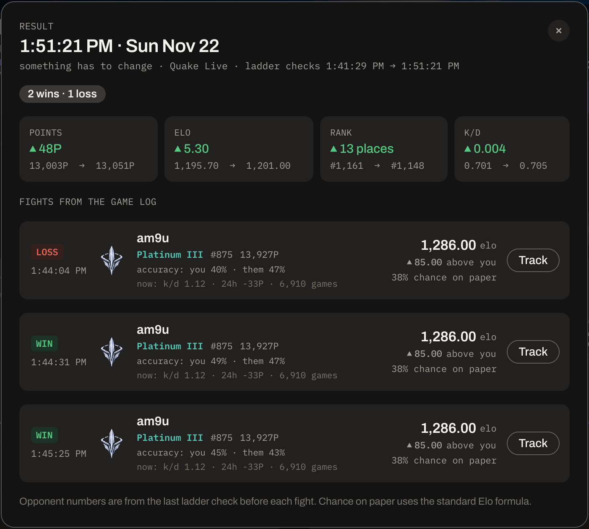
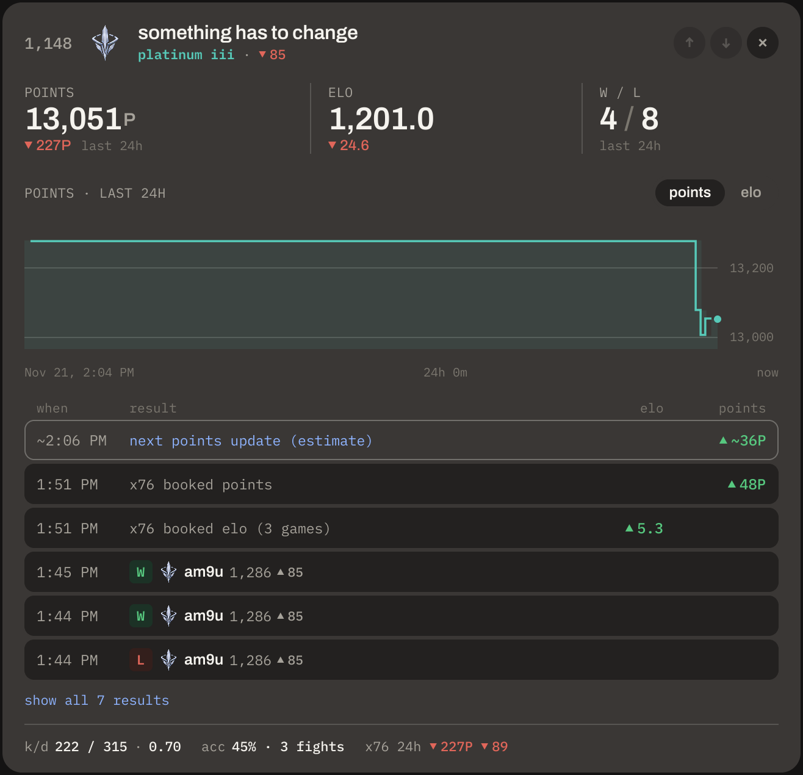
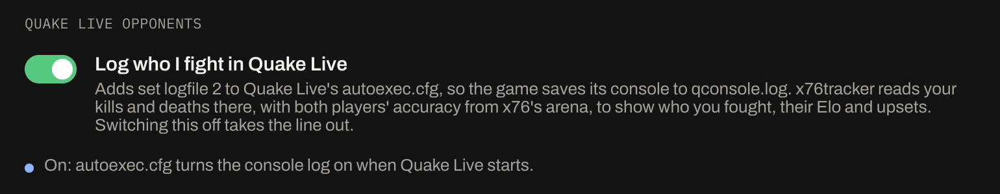
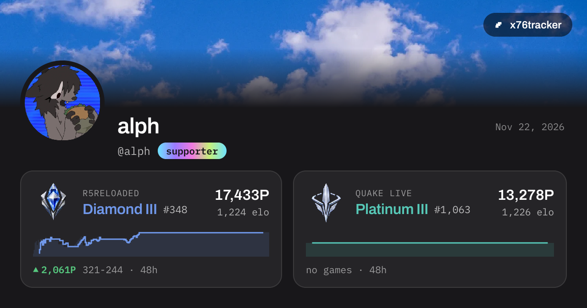
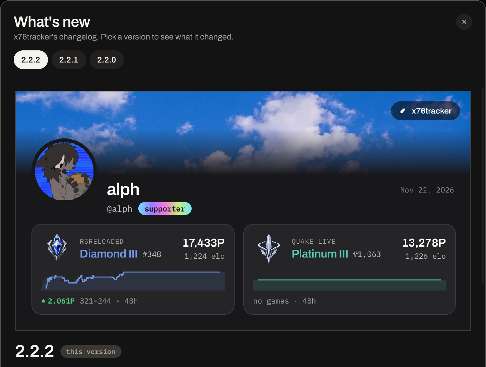
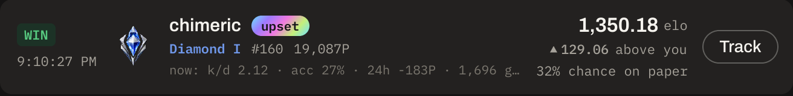
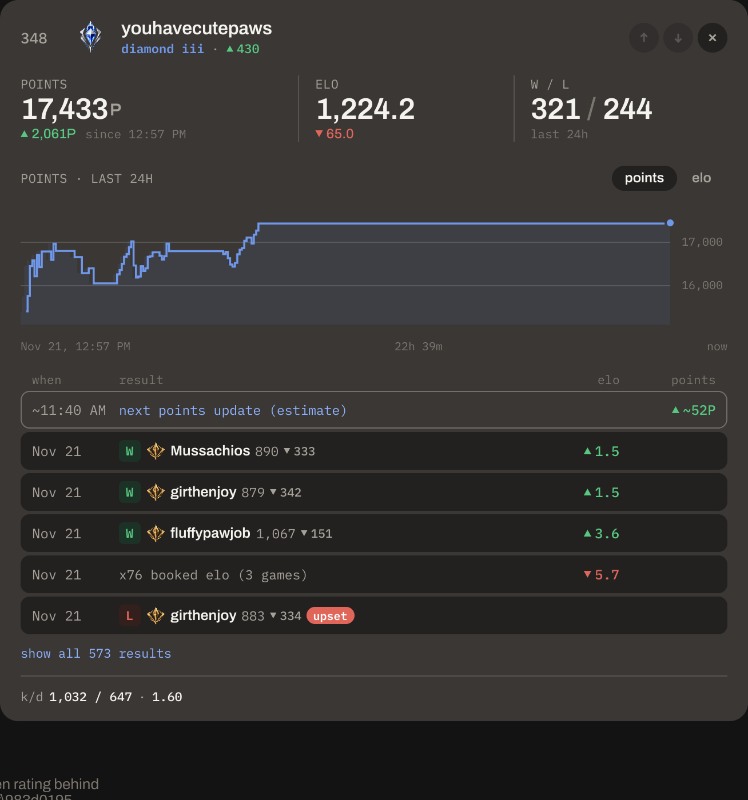
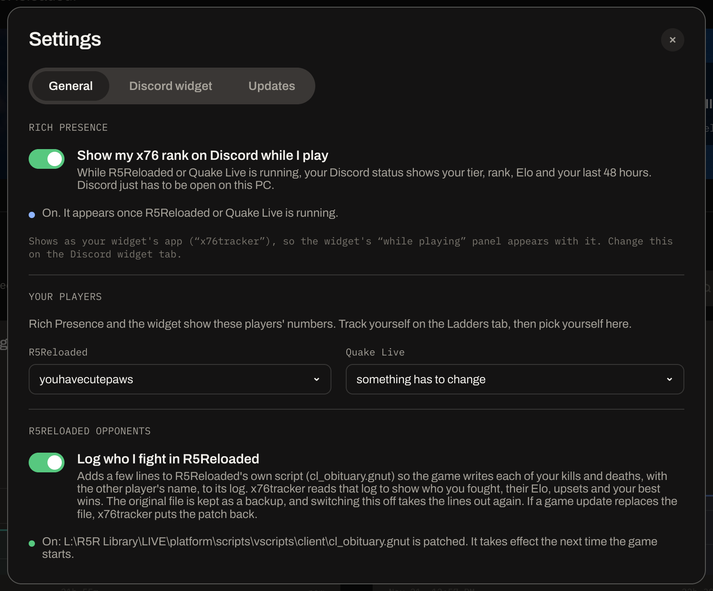

# Changelog

Each version's section is shown in the app (What's new) and used as its GitHub release notes. Pictures are paths in this repository; the moving ones are animated PNGs.

## 2.2.3

### New

- **Quake Live opponents:** your fights in x76's LG arena now show up like R5Reloaded's: who you fought, their tier, rank and Elo, how far above or below you they were, your chance on paper, and upsets. Each fight also shows both players' accuracy, as the x76 server prints it after the fight. Click a result to see its fights, and track an opponent with one click.
  
- **Console log switch:** Settings → General → Log who I fight in Quake Live adds set logfile 2 to Quake Live's autoexec.cfg, so the game saves its console to qconsole.log for x76tracker to read. Switching it off takes the line out again. To start without restarting the game, type \set logfile 2 in its console.
  

### Improved

- **Quake Live stats:** your Quake Live card shows your average accuracy over the period's fights, and your best win of the last 48 hours now works for Quake Live too, on the Discord widget as well.

## 2.2.2

### New

- **Share card:** a picture of your x76 profile and ranks for Discord or anywhere else: your banner and avatar, and for each game the rank emblem, tier, rank, points, Elo and a sparkline of your last 48 hours. Press Share card on your profile, then Save PNG. It's saved to Pictures\x76tracker.
- **What's new:** this menu. Every version's changes with pictures, sorted into new, improved and fixed. It opens by itself the first time a new version starts, and from Settings → Updates any time.
  
- **Update check:** x76tracker asks GitHub for the latest release when it starts and every 6 hours. When there's a new version, an Update button glows in the title bar and opens its notes here.
  
- **Automatic updates:** a new version downloads in the background, is checked against the SHA-256 published with its release, and replaces the old one when you close x76tracker. Turn this off in Settings → Updates to install with one click instead.

### Improved

- **Upsets:** point at an upset you won and a wave of colour washes through its rainbow, then settles back.
  
- **Supporter badge:** the same wave washes through it when you point at it.
  
- **Motion:** menus drop in, panels and tabs fade and rise into place, new results slide down onto the board, and points, Elo and server player counts tick to their new values. Buttons dim when pressed, and the live dot breathes while x76 is being checked.
  

## 2.2.1

### New

- **R5Reloaded opponents switch:** Settings → General can add the game-log patch to R5Reloaded, or take it out, so anyone can see who they fought, with the opponent's Elo, upsets and best wins. The original game file is kept as a backup, and the patch is put back if a game update replaces it.
  
- **Game folder:** if R5Reloaded isn't in the usual R5R Library folder, you can enter its folder in Settings.

## 2.2.0

Released together with 2.2.1.

### New

- **Servers tab:** live player counts on x76's Quake Live and R5Reloaded servers, with totals, today's peak, a 7-day chart and every server.
- **Settings:** a new Settings window (the sliders button in the title bar), where you pick whose numbers Discord shows.
- **Discord Rich Presence:** while R5Reloaded or Quake Live is running, your Discord status shows your tier, rank, Elo and last 48 hours.
- **Discord profile widget:** if your Discord app already has a profile widget, x76tracker fills its User Data fields: stat tiles, cards with your x76 rank emblem, or a progress bar to your next tier with a 48-hour summary.
  
- **Verified builds:** releases are built by GitHub Actions straight from the repository and carry a signed build attestation, so you can check a download came from this code.

### Fixed

- **Closing the window:** it always quits the app now. Before, it could keep running hidden after a dropdown had been opened.
