# Changelog

Each version's section is shown in the app (What's new) and used as its GitHub release notes. Pictures are paths in this repository; the moving ones are animated PNGs.

## 2.3.2

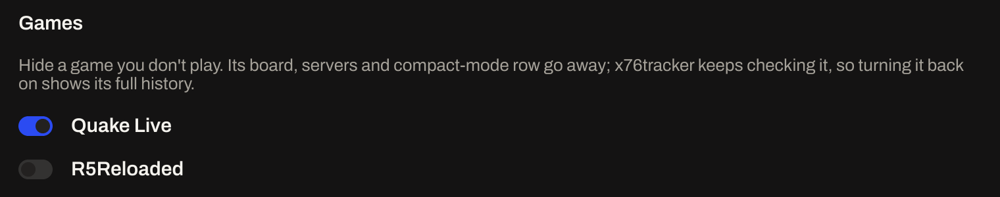

### New

- **Hide a game:** Settings → General → Games has a switch for Quake Live and one for R5Reloaded. Turn one off and its board, its servers and its compact-mode row go away, and the other game takes the full width. x76tracker keeps checking a hidden game, so turning it back on shows its full history. One game always stays on. Thanks to xvv for asking for this!

## 2.3.1

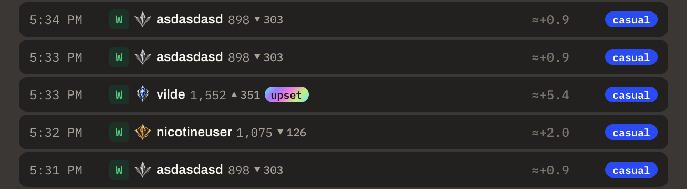

### New

- **Casual fights (Quake Live):** fights x76 never booked on the ladder, because you or the other player had casual on, get a blue casual bubble at the end of their row. Each one also shows about how much Elo it would have been worth on ranked, using how much x76 moves your Elo per fight (learnt from your own ranked games) and both players' Elo at the time. Your Quake Live W/L counts casual games too, so it isn't empty when you play casual. x76 books ranked fights a few minutes late, so a fight gets its bubble about 20 minutes after it, once x76tracker has read the ladder and found it wasn't booked.

### Improved

- **Pills:** the Today / Last 24h / All tracked and points / elo switches are back in Archivo semibold, like x76's own pills. The chosen option still slides over.
- **Cleaner cards:** the k/d, accuracy and x76 24h line under the Quake Live and R5Reloaded cards is gone.
- **Results:** a ladder check where nothing changed no longer shows up as an "adjusted" result.

### Fixed

- **Settings switches:** the game-log, recap and notification switches now flip as soon as you change them. Before, the status under them changed but the switch could stay where it was.

## 2.3.0

### New

- **Quake Live opponents:** your fights in x76's LG arena now show up like R5Reloaded's: who you fought, their tier, rank and Elo, how far above or below you they were, your chance on paper, and upsets. Each fight also shows both players' accuracy, as the x76 server prints it after the fight. Click a result to see its fights, and track an opponent with one click.
  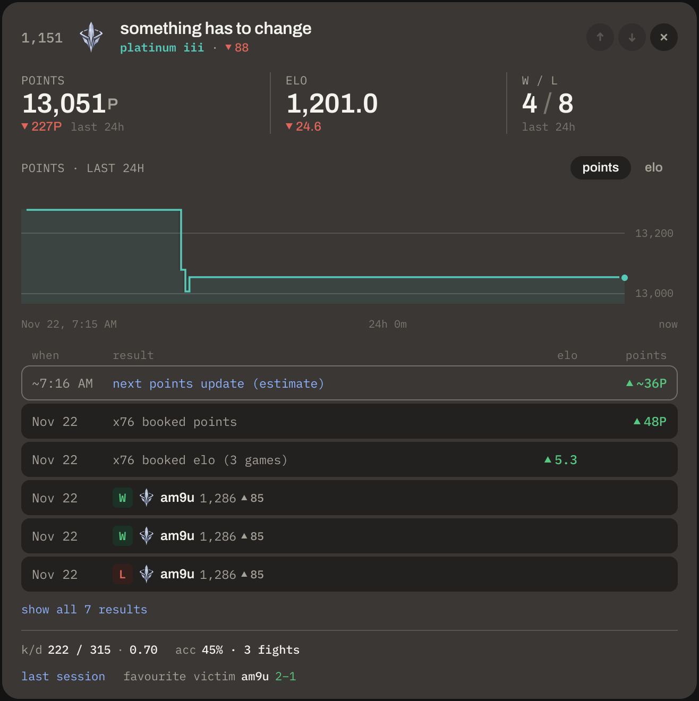
- **Console log switch:** Settings → General → Log who I fight in Quake Live adds set logfile 2 to Quake Live's autoexec.cfg, so the game saves its console to qconsole.log for x76tracker to read. Switching it off takes the line out again. To start without restarting the game, type \set logfile 2 in its console.
  
- **Rivals:** click an opponent's name in a result's fights, or in your card's footer, to see your head-to-head with them. It shows your all-time record and their Elo now. You also get both players' accuracy in Quake Live or the upsets in R5Reloaded, when you first met, and every fight between you.
  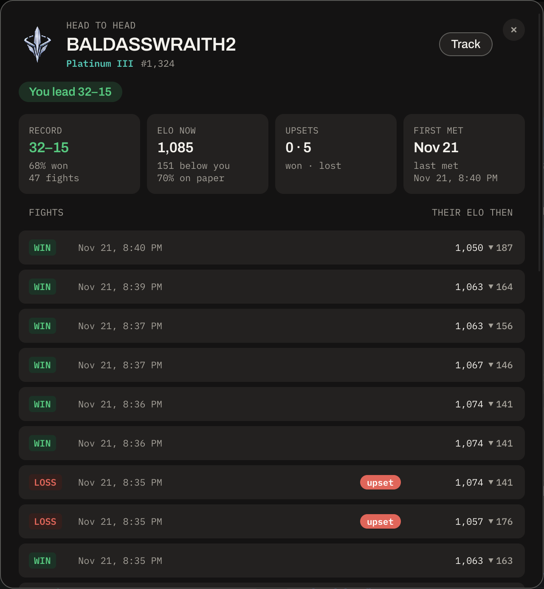
- **Nemesis and favourite victim:** your card's footer names the opponent who beat you most in the period and the one you beat most, with your record against each. Click either name for your head-to-head with them.
  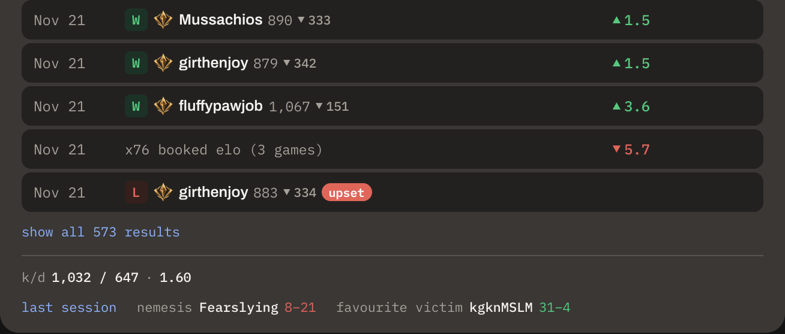
- **Session recap:** x76tracker notices when R5Reloaded or Quake Live starts and closes. When the game closes, it shows a summary of the session: wins and losses, tier change, points, Elo, rank and accuracy. It also names your best win, nemesis, favourite victim, upsets and who you fought most. Step back through older sessions, or open the last one from your card's last session link. You can turn the recap off in Settings → General.
  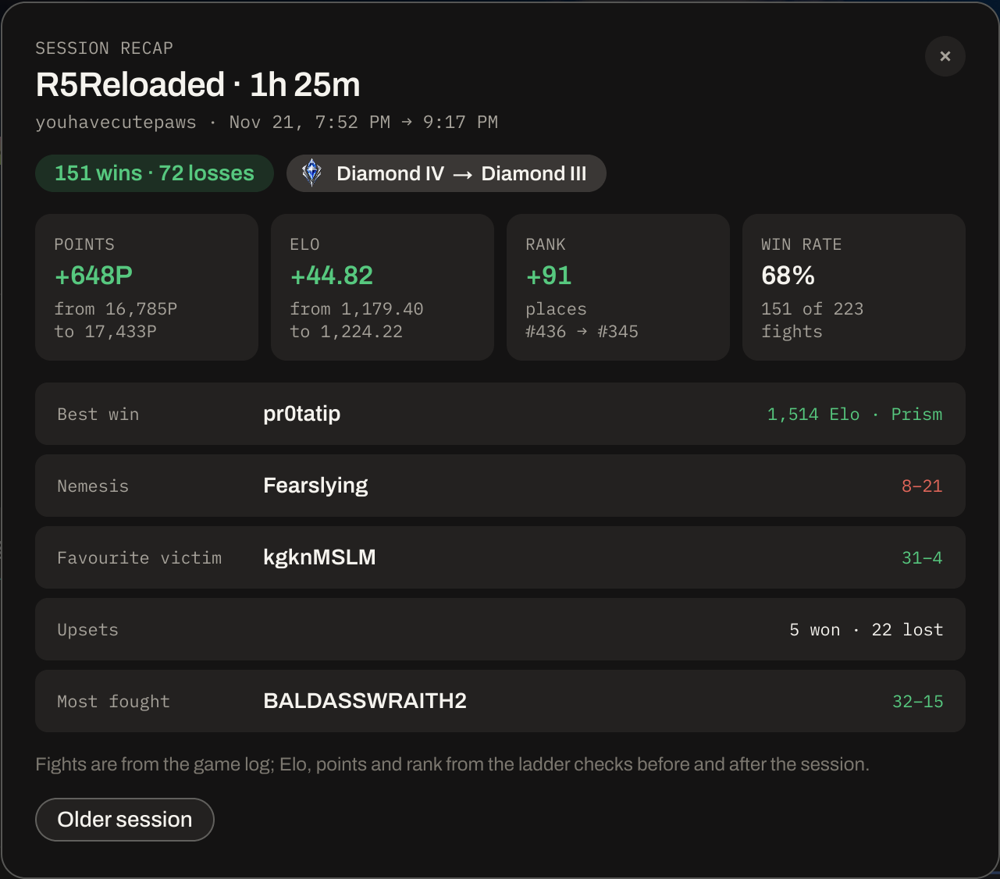
- **Notifications:** a small card in x76tracker's own style slides in at the bottom right and leaves by itself a few seconds later. It shows up when your tier changes, when you reach a rank milestone (top 100, top 50 and so on), when you pass a player you track or one passes you, and when a session ends. It shows over your game without taking focus, and clicking it brings up x76tracker. Notifications are off until you turn them on in Settings → General, where Preview shows you one.
  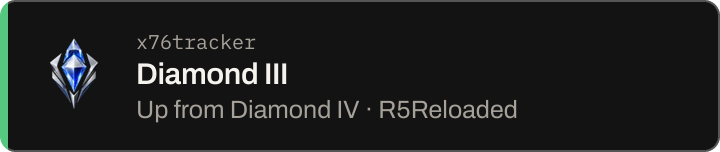
- **Compact mode:** the new button in the title bar opens a small card that stays on top of other windows. It shows your players' tier, rank and Elo, the change this session (or over 48 hours), the last fight and your streak. Drag it anywhere and it stays there next time. Double-click it to bring up x76tracker.
  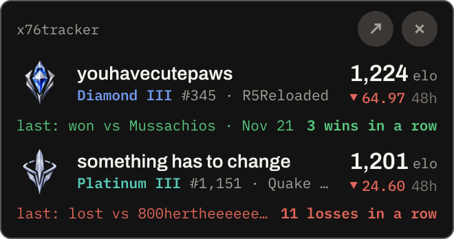

### Improved

- **Quake Live stats:** your Quake Live card shows your average accuracy over the period's fights.
- **Discord is experimental:** Rich Presence and the profile widget moved to their own tab, Settings → Experimental. Both are off until you turn them on, and nothing changes if you already use them.
  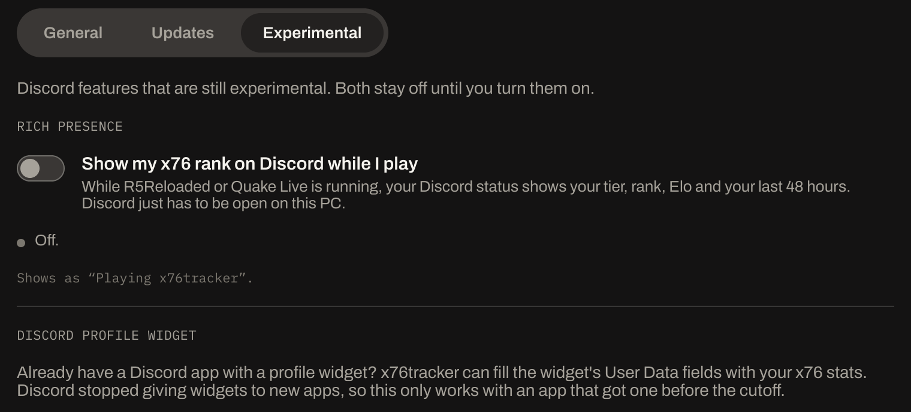
- **Looks more like x76.gg:** switches are x76 blue, smaller, and their knob springs across. Avatars are rounded squares. The Today / Last 24h / All tracked and points / elo switches are x76's mono filter pills, and the chosen option slides over. Settings headings are in sentence case. Servers show online or offline as a word, with one blue segment per player slot. Pop-ups dim the window in its own warm colour instead of black, and loading messages lose their "…".

### Fixed

- **Sharper pictures:** rank emblems, your avatar and banner, and the pictures in What's new are resized smoothly to the exact size they're shown at, in the app and in saved share cards. Before, shrinking them dropped pixels, so emblems looked grainy and text in pictures looked thin and jagged. In the picture, the top half is before the fix and the bottom half is now.
  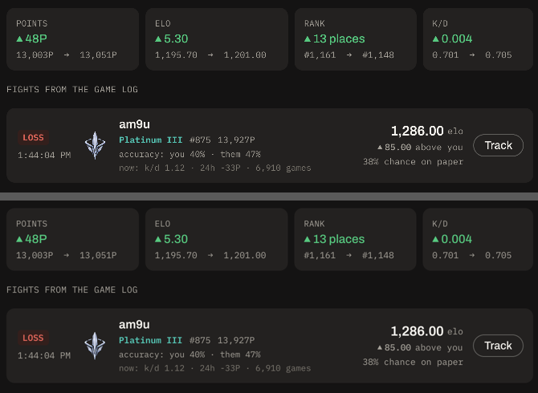

## 2.2.2

### New

- **Share card:** a picture of your x76 profile and ranks for Discord or anywhere else: your banner and avatar, and for each game the rank emblem, tier, rank, points, Elo and a sparkline of your last 48 hours. Press Share card on your profile, then Save PNG. It's saved to Pictures\x76tracker.
- **What's new:** this menu. Every version's changes with pictures, sorted into new, improved and fixed. It opens by itself the first time a new version starts, and from Settings → Updates any time.
  
- **Update check:** x76tracker asks GitHub for the latest release when it starts and every 6 hours. When there's a new version, an Update button glows in the title bar and opens its notes here.
  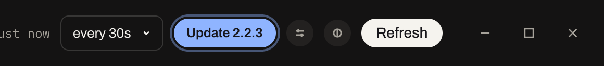
- **Automatic updates:** a new version downloads in the background, is checked against the SHA-256 published with its release, and replaces the old one when you close x76tracker. Turn this off in Settings → Updates to install with one click instead.

### Improved

- **Upsets:** point at an upset you won and a wave of colour washes through its rainbow, then settles back.
  
- **Supporter badge:** the same wave washes through it when you point at it.
  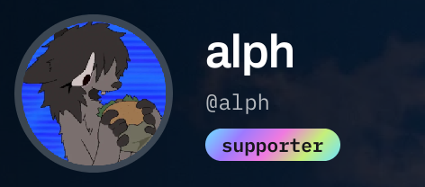
- **Motion:** menus drop in, panels and tabs fade and rise into place, new results slide down onto the board, and points, Elo and server player counts tick to their new values. Buttons dim when pressed, and the live dot breathes while x76 is being checked.
  

## 2.2.1

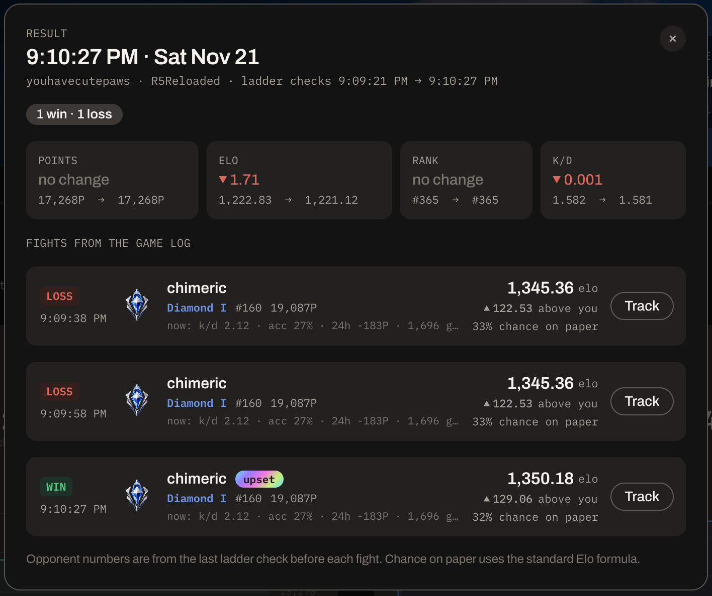

### New

- **R5Reloaded opponents switch:** Settings → General can add the game-log patch to R5Reloaded, or take it out, so anyone can see who they fought, with the opponent's Elo, upsets and best wins. The original game file is kept as a backup, and the patch is put back if a game update replaces it.
  
- **Game folder:** if R5Reloaded isn't in the usual R5R Library folder, you can enter its folder in Settings.

## 2.2.0

Released together with 2.2.1.

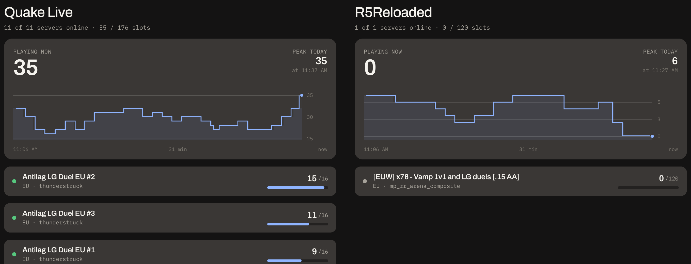

### New

- **Servers tab:** live player counts on x76's Quake Live and R5Reloaded servers, with totals, today's peak, a 7-day chart and every server.
- **Settings:** a new Settings window (the sliders button in the title bar), where you pick whose numbers Discord shows.
- **Discord Rich Presence:** while R5Reloaded or Quake Live is running, your Discord status shows your tier, rank, Elo and last 48 hours.
- **Discord profile widget:** if your Discord app already has a profile widget, x76tracker fills its User Data fields: stat tiles, cards with your x76 rank emblem, or a progress bar to your next tier with a 48-hour summary.
  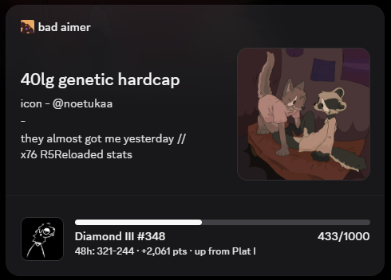
- **Verified builds:** releases are built by GitHub Actions straight from the repository and carry a signed build attestation, so you can check a download came from this code.

### Fixed

- **Closing the window:** it always quits the app now. Before, it could keep running hidden after a dropdown had been opened.
