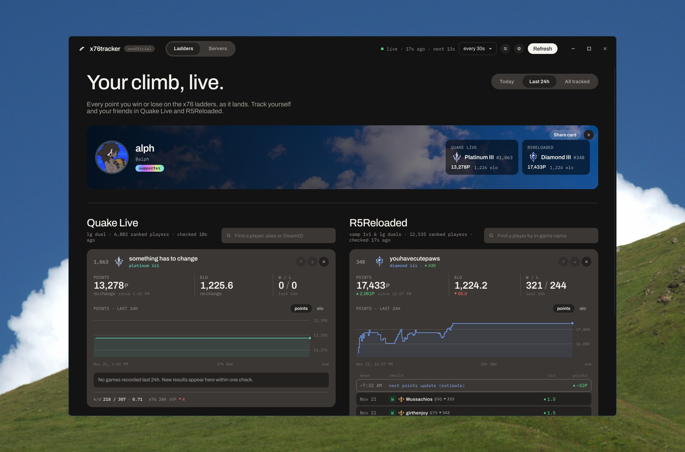
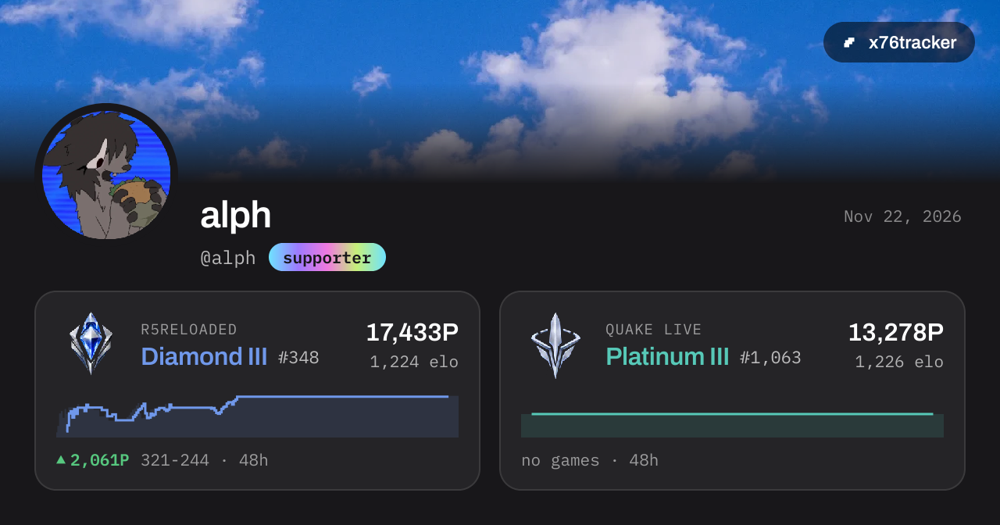
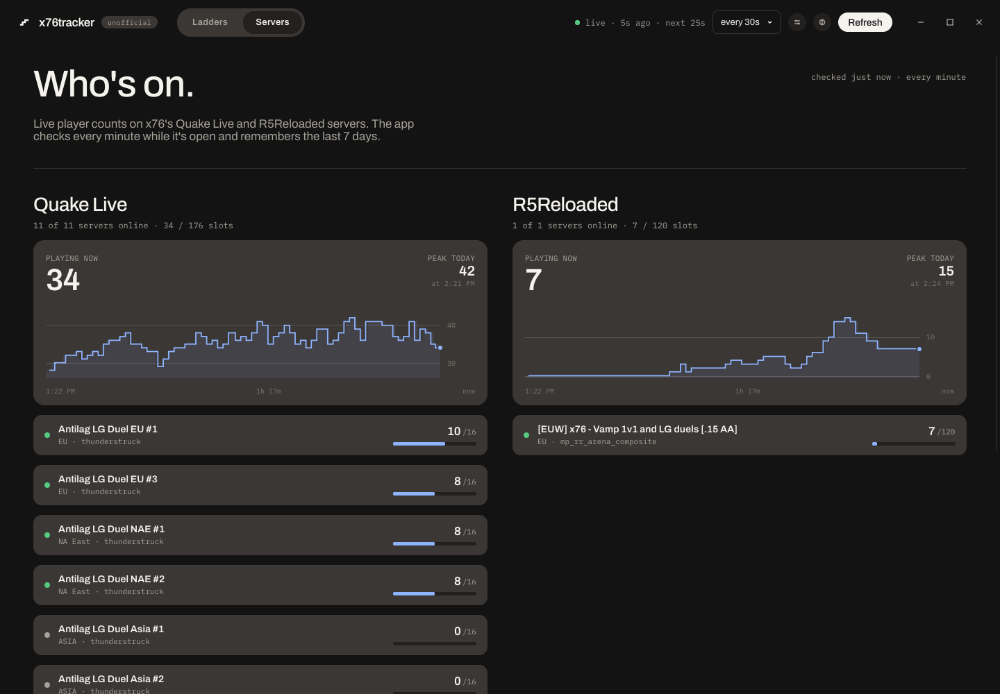
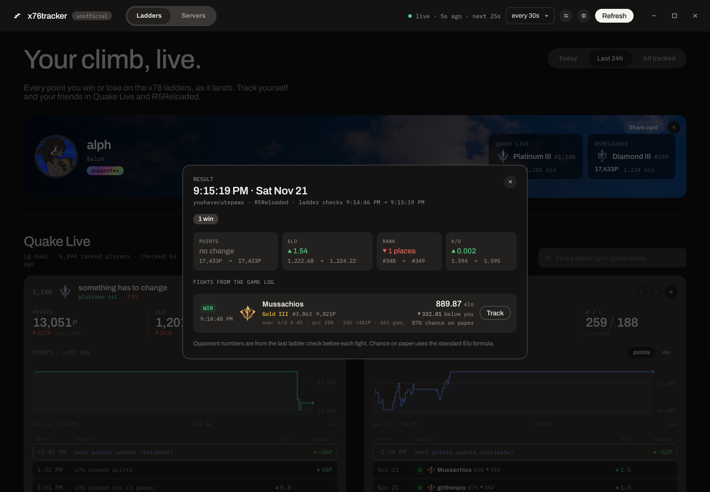
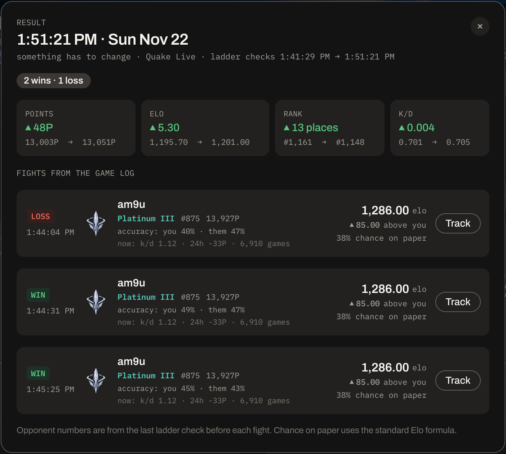
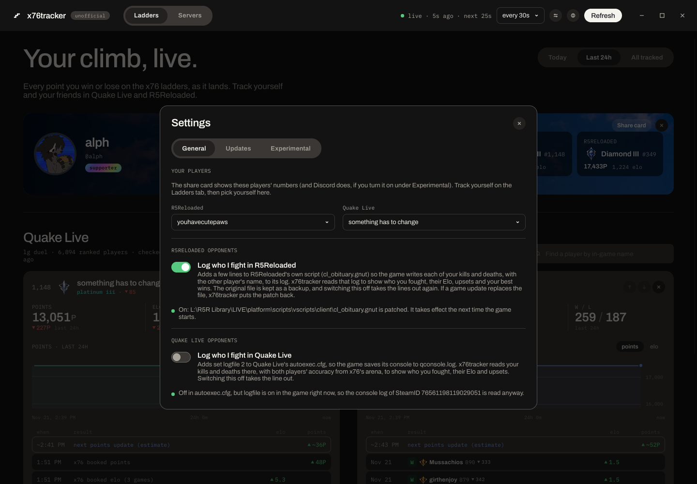
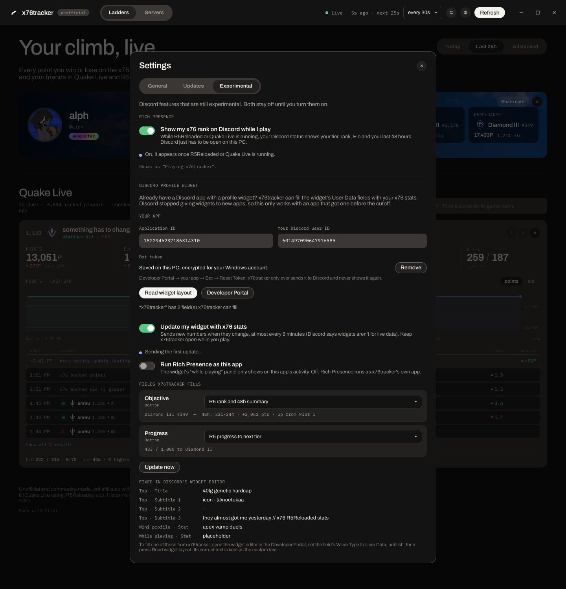
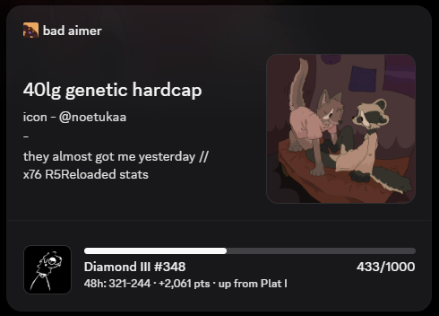
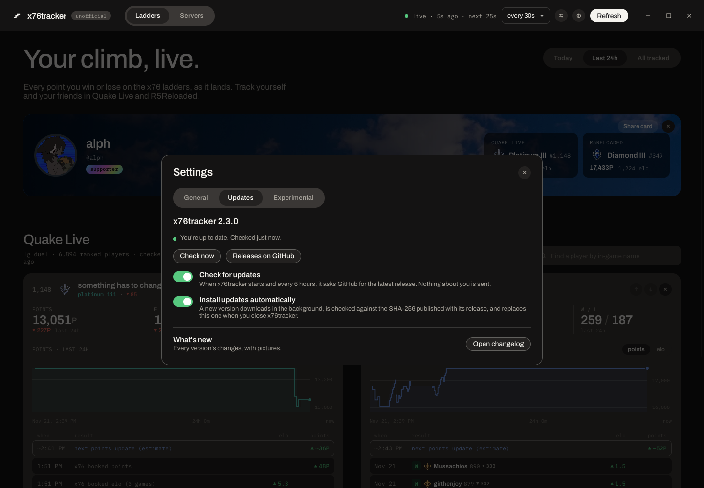
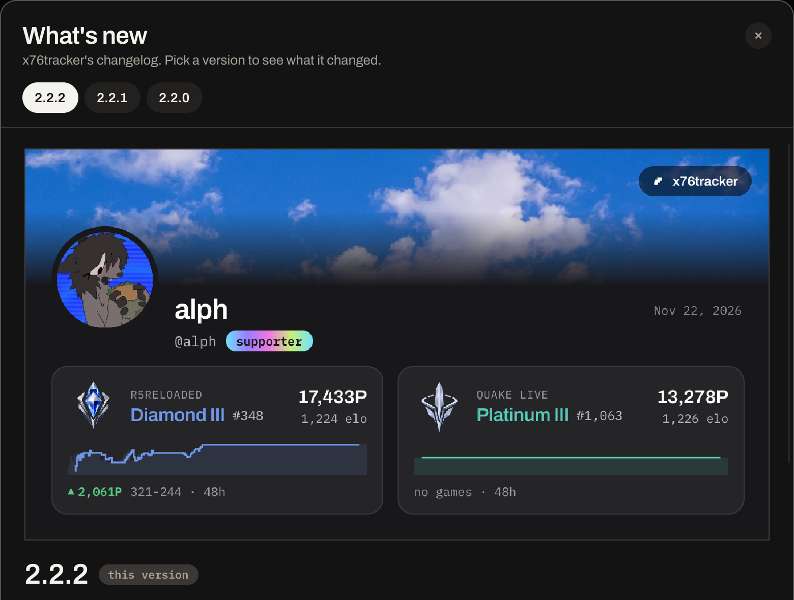

# x76tracker

A Windows app (download `x76tracker.exe` from the [Releases](../../releases/latest) page). It tracks your **points and Elo** on the [x76.gg](https://x76.gg/leaderboard/) Quake Live and R5Reloaded ladders, live, for any players you pick. No login.

> Unofficial and community-made. Not affiliated with x76.gg.



## Use it

1. Run `x76tracker.exe`. Nothing to install.
2. Search your name under **Quake Live** or **R5Reloaded** and click **Track**.
3. Keep the window open while you play. Closing it stops tracking.

What you get:
- **Points and Elo:** your change for Today, Last 24h or All tracked.
- **Ladder position:** your rank and tier.
- **Wins and losses** for the period.
- **Chart:** points or Elo over time; hover it for exact values.
- **Results list:** the elo and points change of each result.
- **Live updates:** cards light up green or red when something changes.
- **Servers tab:** live player counts on x76's Quake Live and R5Reloaded servers.
- **Share card:** your profile and ranks as a PNG for Discord or anywhere else (Share card on your profile, then Save PNG).





## R5Reloaded opponents (optional)

The x76 ladder only shows totals, so on its own x76tracker can't tell who you fought. Turn on **Settings → General → Log who I fight in R5Reloaded** and x76tracker adds a few lines to R5Reloaded's own script, `platform\scripts\vscripts\client\cl_obituary.gnut`. A mod can't do this, because R5Reloaded mods can't replace game scripts. The added lines write one line to the game's `script.log` for each of your kills and deaths (who, by whom, which weapon) and change nothing else. x76tracker reads that log to list each fight with the opponent's Elo, the upsets, and your best wins.

- The original file is saved next to it as `cl_obituary.gnut.bak-x76tracker`. Switching the setting off takes the lines out again.
- It takes effect the next time the game starts.
- If a game update replaces the file, x76tracker puts the patch back while it's running. To undo it by hand, copy the backup over the file or repair the game in the R5Reloaded launcher.
- The game is found in the usual install folders (`R5R Library`). If yours is somewhere else, enter its folder in Settings.



## Quake Live opponents (optional)

The same for Quake Live's LG arena, without changing the game. Quake Live can save everything its console shows to `qconsole.log`, and x76's server prints a line for each kill plus both players' accuracy after every fight you're in. Turn on **Settings → General → Log who I fight in Quake Live** and x76tracker adds `set logfile 2` to your account's `autoexec.cfg` (in `Quake Live\<SteamID>\baseq3`). x76tracker follows the log, finds your kills and deaths by your in-game name, and looks each opponent up on the ladder by name.

- It takes effect the next time Quake Live starts. To start right away, type `\set logfile 2` in the game's console.
- `autoexec.cfg` is saved first as `autoexec.cfg.bak-x76tracker`. Switching the setting off takes the line out again. The x76 launcher keeps its own line in the same file and leaves other lines alone.
- The log has no times in it, so a fight gets the time x76tracker read it, a couple of seconds after it happened. Fights from while x76tracker was closed get estimated times, and Quake Live starts the log over each time the game starts.
- The account folder's name is your SteamID, which is also your id on the Quake Live ladder, so the fights go to the right player.



## Discord (experimental)

Both Discord features are experimental and off until you turn them on, in **Settings → Experimental** (Settings is the sliders button in the title bar).

- **Rich Presence:** while R5Reloaded or Quake Live is running, your Discord status shows your tier, rank, Elo and your last 48 hours. Discord just has to be open on the same PC; there's no login.
- **Profile widget:** for people who already have a Discord app with a profile widget (Discord no longer gives widgets to new apps). Under **Discord profile widget**, enter the app's Application ID and paste its bot token. x76tracker reads the widget's layout and fills each field set to *User Data* with a stat you pick (current numbers or the last 48 hours), at most every 5 minutes. In a *Collection* layout each item becomes a card with a picture: your x76 rank emblem, or an emoji that follows your results. In a *Progress* layout, the bar shows how far you are through your tier. The token is stored encrypted for your Windows account (`discord-token.bin`) and only sent to Discord.



| Settings → Experimental | What the widget fills in on Discord |
|---|---|
|  |  |

## Options

```
x76tracker.exe --data-dir D:\x76            keep history somewhere else
x76tracker.exe --screenshot out.png [--size 1440x1000] [--light|--dark] [--hover x,y] [--click x,y] [--offline]
               [--tab servers] [--settings general|widget|updates] [--preview-update 2.3.0]
                                            draw the window into a PNG without showing it
                                            (--preview-update pretends that version is on GitHub)
x76tracker.exe --screenshot out.png [--whats-new N] [--detail | --detail-upset] [--detail-game ql]
               [--record FRAMES [--fps 20] [--crop x,y,w,h] [--click-at F] [--hover-at F]]
                                            open What's new or a result; --record writes an animated PNG
x76tracker.exe --card out.png              the share card alone, as a 1280×672 PNG
```

The `--screenshot` options exist only in builds made with `cargo build --release --features docs`; release builds leave them out. They draw x76tracker's own window into an image in memory (no screen capture). `docs\screenshots.ps1` renders the standard screenshots in `docs/images` this way; add `--scale 2` for double resolution.

## Updates

x76tracker checks GitHub for a new version when it starts and every 6 hours. A new version downloads in the background, is checked against the SHA-256 published with its release, and is installed when you close the app. **Settings → Updates** turns either part off and installs right away. **What's new** shows every version's changes with pictures, sorted into new, improved and fixed ([CHANGELOG.md](CHANGELOG.md)); it opens by itself after an update. A copy built from source (run from cargo's `target` folder) never replaces itself.

| Settings → Updates | What's new |
|---|---|
|  |  |

## Verify your download

Release builds are made by this repository's GitHub Actions workflow ([`.github/workflows/build.yml`](.github/workflows/build.yml)) on GitHub's own machines, not on anyone's PC. Each one comes with a signed build attestation. With the [GitHub CLI](https://cli.github.com):

```
gh attestation verify x76tracker.exe --repo vocaloidcats/x76tracker
```

This confirms the file was built by that workflow from this repository, and names the exact commit. Without the CLI, compare `Get-FileHash x76tracker.exe` with the `x76tracker.exe.sha256` file on the release page.

## Build

You need [Rust](https://rustup.rs) and Microsoft's C++ Build Tools. Then run:

```
cargo build --release
```

This produces `target\release\x76tracker.exe`.

| File | What it is |
|---|---|
| `src/tracker.rs` | Downloads the ladders, saves change history, search. |
| `src/view.rs` | Turns history into cards, charts and status lines (Today / Last 24h / All tracked). |
| `src/main.rs` | Window, button handlers, the background check loop, single-instance check. |
| `src/r5log.rs` | Reads fights from R5Reloaded's `script.log` (written by the optional patch). |
| `src/r5patch.rs` | Adds the optional patch to R5Reloaded's script, or takes it out. |
| `src/servers.rs` | x76's server list and the player-count history for the Servers tab. |
| `src/discord.rs` | Discord settings, the profile widget's layout and updates, the encrypted bot token. |
| `src/rpc.rs` | Rich Presence through Discord's local pipe, and spotting when a game is running. |
| `src/update.rs` | Update check, download, SHA-256 check and swap; the in-app changelog. |
| `CHANGELOG.md` | What changed in each version. Built into the app and used as the release notes. |
| `docs/screenshots.ps1` | Renders the README's screenshots from your own data. |
| `ui/app.slint` | The UI, styled after x76.gg: Archivo and IBM Plex Mono, paper/ink colours, tier colours. |

The app draws its window with Slint's software renderer. Slint's GPU renderer placed some letters a pixel off the line.

## Licensing notes

- **The app:** MIT, see `LICENSE`.
- **Slint:** used under its free Royalty-free License for desktop apps. That license requires a visible Slint credit; the app shows "Made with Slint" at the bottom of the window.
- **Fonts:** Archivo and IBM Plex Mono are under the SIL Open Font License; the license files are in `ui/fonts/`.
- **Widget pictures:** the emoji are Microsoft's [Fluent Emoji](https://github.com/microsoft/fluentui-emoji) (MIT), and the rank emblems are x76.gg's own artwork. Neither is bundled: Discord loads them from those sites.
